# 🎮 ארקייד נוסטלגיה וענן לטלוויזיות LG webOS Smart TV
### LG Smart TV webOS Ultimate Retro Cloud Arcade & Nostalgia Collection — 206+ Games, Hebrew Localization & IPK Packages

<p align="center">
  
</p>

<p align="center">
  
  
  
  
  
  
</p>

---

## 📖 אודות הפרויקט (Project Overview)

מאגר זה מהווה את **אוסף משחקי הרטרו והארקייד הגדול והמקיף ביותר שנוצר אי פעם עבור מערכת ההפעלה LG webOS** בטלוויזיות חכמות (LG OLED, QNED, NanoCell ו-UHD).

הפרויקט כולל **קטלוג ענק של מעל 200 משחקי רטרו נוסטלגיים (206 משחקים מאומתים!)**, המחולקים לפי קונסולות ומערכות:
* 🎮 **נינטנדו NES / Famicom (מעל 60 משחקים):** מריו 1-3, קונטרה, מגה מן 1-3, קסטלווניה 1-3, נינג'ה גאידן 1-3, קרב טנקים, צבי הנינג'ה, גול 3, קפטן סובאסה ועוד.
* 🦔 **סגה Genesis / Mega Drive (מעל 45 משחקים):** סוניק 1-3, סוניק ונאקלס, רחובות הזעם 1-3, גרזן הזהב 1-3, מורטל קומבט 1-3, שינובי 3, אלאדין, מלך האריות ועוד.
* 💀 **משחקי DOS ו-PC שנות ה-90 (מעל 35 משחקים):** דייב המסוכן בעברית 1 ו-2, דום 1.9 ו-2, וולפנשטיין 3D, דיוק ניוקם 1-3D, קומנדר קין, הנסיך הפרסי 1-2, חתול הרחוב, סקיירודס, סופפלקס, למינגס, וורמס ועוד.
* ⚡ **משחקי פלאש ונוסטלגיית אינטרנט (מעל 35 משחקים):** Angry Birds Rio, Classic, Space, Seasons, Star Wars, Cut the Rope, Bad Piggies, Fruit Ninja, Flappy Bird 4K, פנסי פאנטס, ילד אש וילדת מים, עידן המלחמה (Age of War), חרבות וסנדלים ועוד.
* 🕹️ **ארקייד מטבעות וקלאסיקות שנות ה-80 (מעל 25 משחקים):** פאק-מן, גברת פאק-מן, ספייס אינוויידרס, אסטרואידים, פונג, ברייק-אאוט, גלאגה, פרוגר, קיו-ברט, אייר-קסוניקס 3D, פאק-סוניקס, טטריס קלאסי ועוד.

כל המשחקים עברו התאמה מלאה לרזולוציית מסך סלוני (**1080p ו-4K 60FPS**), עברות ממשקים וכיתובים לשפה העברית, אינטגרציה קולית עם מנועי Web Audio, תמיכה מלאה בשלט **LG Magic Remote** ובחיצי ה-**D-Pad**, מנוע חיפוש פנימי מהיר בעברית ובאנגלית, וסינון לפי קטגוריות.

---

## 🌟 תכונות מפתח (Key Features)

* **206 משחקי רטרו פעילים:** מאגר ענקי וחסר תקדים הנגיש בלחיצת כפתור אחת מהשלט.
* **מנוע חיפוש אינטראקטיבי (Live Search):** הקלד שם משחק בעברית או באנגלית בשורת החיפוש העליונה (למשל: מריו, סוניק, דום, קונטרה, טטריס) לקבלת תוצאות מיידיות.
* **ענן והורדה מקוונת (GitHub Cloud Sync):** משיכה ישירה של משחקים, חבילות שלבים ותוכן מה-GitHub Repository עם תמיכה מלאה במשחק אונליין ובמצב מקומי מהיר (Offline Fallback).
* **תמיכה מלאה בשלטי LG Magic Remote:** מתיחת רוגטקה ב-Angry Birds Rio, חיתוך חבלים מדויק ב-Cut the Rope, ירי אקדח אור (Light Gun) ב-Duck Hunt, ומשחקיות פלאפי בירד בקליק אחד.
* **עברות מלא (Hebrew UI & Fonts):** תפריטים, הוראות, מקשים, שלבים ולוחות ניקוד בעברית מלאה וישרה (RTL Native).
* **אופטימיזציה ייעודית לחומרת LG TV:** שימוש ברינדור חומרתי מואץ GPU דרך Canvas 2D ו-WebGL, עם זמני טעינה אפסיים וצריכת זיכרון מינימלית.
* **שתי דרכי התקנה לבחירה:**
  1. **ארקייד נוסטלגיה (Master Hub IPK):** חבילה אחת שלמה שמרכזת את כל 206 המשחקים בממשק טלוויזיוני עתידני.
  2. **חבילות IPK בודדות (Standalone):** כל אחד ממשחקי המפתח המובנים זמין גם כקובץ IPK נפרד להוספה ישירה לשורת האפליקציות הביתית של ה-webOS.

---

## 📦 טבלת החבילות להורדה ישירה (v4.0.0 Catalog)

| אייקון | שם המשחק | מזהה חבילה (App ID) | סגנון משחק | סוג שליטה | גודל קובץ | קישור להורדת IPK |
| :---: | :--- | :--- | :---: | :---: | :---: | :---: |
|  | 🌟 **ארקייד נוסטלגיה בענן (206+ משחקים)** | `com.retrohub.nostalgia` | רכזת ארקייד מאוחדת | שלט Magic / חיצים / גיימפאד | ~35.2 MB | [הורד IPK מאוחד (v4.0.0)](https://github.com/dor2500/webos-tv-games/releases/download/v4.0.0/com.retrohub.nostalgia_4.0.0_all.ipk) |
| 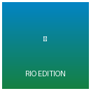 | 🦜 **Angry Birds Rio (ריו HD)** | `com.rovio.angrybirdsrio` | פיזיקה ופאזל | סמן Magic Remote (פוינטר) | ~10 KB | [הורד IPK](https://github.com/dor2500/webos-tv-games/releases/download/v4.0.0/com.rovio.angrybirdsrio_1.0.0_all.ipk) |
| 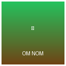 | 🍬 **Cut the Rope (חתוך את החבל)** | `com.dor.cuttherope` | פיזיקה ומיומנות | סמן Magic Remote לחיתוך | ~10 KB | [הורד IPK](https://github.com/dor2500/webos-tv-games/releases/download/v4.0.0/com.dor.cuttherope_1.0.0_all.ipk) |
| 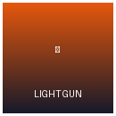 | 🦆 **דאק האנט (Duck Hunt)** | `com.dor.duckhunt` | אקדח אור ארקייד | כיוון פוינטר + אישור לירי | ~9 KB | [הורד IPK](https://github.com/dor2500/webos-tv-games/releases/download/v4.0.0/com.dor.duckhunt_1.0.0_all.ipk) |
| 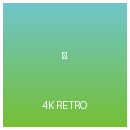 | 🐥 **פלאפי בירד 4K (Flappy Bird)** | `com.dor.flappybird` | ארקייד תזמון | סמן שלט / כפתור אישור | ~10 KB | [הורד IPK](https://github.com/dor2500/webos-tv-games/releases/download/v4.0.0/com.dor.flappybird_1.0.0_all.ipk) |
| 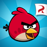 | 🐦 **Angry Birds Classic** | `com.rovio.angrybirds` | פיזיקה ודיוק | סמן Magic Remote | ~1.93 MB | [הורד IPK](https://github.com/dor2500/webos-tv-games/releases/download/v4.0.0/com.rovio.angrybirds_4.0.0_all.ipk) |
| 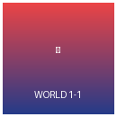 | 🍄 **סופר מריו קלאסי (עולם 1-1)** | `com.dor.mario` | פלטפורמת NES | חיצי D-Pad + אישור לקפיצה | ~10 KB | [הורד IPK](https://github.com/dor2500/webos-tv-games/releases/download/v4.0.0/com.dor.mario_1.0.0_all.ipk) |
|  | 🦔 **סוניק הקיפוד בעברית** | `com.sega.ultimateflashsonic` | פלטפורמה מהירה | חיצים + מקש אישור / גיימפאד | ~24.58 MB | [הורד IPK](https://github.com/dor2500/webos-tv-games/releases/download/v4.0.0/com.sega.ultimateflashsonic_1.0.1_all.ipk) |
| 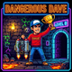 | 🧢 **דייב המסוכן בעברית (DOS)** | `com.dor.dangerousdave` | פלטפורמת DOS | חיצים + אישור לקפיצה וירי | ~620 KB | [הורד IPK](https://github.com/dor2500/webos-tv-games/releases/download/v4.0.0/com.dor.dangerousdave_1.0.0_all.ipk) |
|  | 🏰 **Icy Tower - מהדורת מריו HD** | `com.freelunchdesign.icytower` | טיפוס ומיומנות | חיצים לתנופה + אישור לקפיצה | ~3.07 MB | [הורד IPK](https://github.com/dor2500/webos-tv-games/releases/download/v4.0.0/com.freelunchdesign.icytower_1.3.1_all.ipk) |
|  | 💀 **דום קלאסי בעברית (DOOM 1.9)** | `com.idsoftware.doom` | יריות תלת-מימד | חיצים לתנועה + אישור לירי | ~2.35 MB | [הורד IPK](https://github.com/dor2500/webos-tv-games/releases/download/v4.0.0/com.idsoftware.doom_1.9.0_all.ipk) |
| 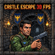 | 🏰 **וולפנשטיין 3D בעברית** | `com.idsoftware.wolf3d` | יריות תלת-מימד | חיצים לתנועה + אישור לירי | ~620 KB | [הורד IPK](https://github.com/dor2500/webos-tv-games/releases/download/v4.0.0/com.idsoftware.wolf3d_1.0.0_all.ipk) |
| 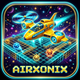 | 🛸 **אייר-קסוניקס 3D בעברית** | `com.dor.airxonix` | חיתוך שטחים 3D | חיצי שלט LG להטיית רחפן | ~780 KB | [הורד IPK](https://github.com/dor2500/webos-tv-games/releases/download/v4.0.0/com.dor.airxonix_1.0.0_all.ipk) |
| 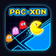 | 🟡 **פאק-סוניקס בעברית** | `com.dor.pacxon` | ארקייד / קסוניקס | חיצי D-Pad לכיבוש שטח | ~590 KB | [הורד IPK](https://github.com/dor2500/webos-tv-games/releases/download/v4.0.0/com.dor.pacxon_1.0.0_all.ipk) |
| 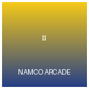 | 🍒 **פאק-מן 1980 קלאסי** | `com.dor.pacman` | ארקייד מבוך | חיצי D-Pad לניווט במבוך | ~12 KB | [הורד IPK](https://github.com/dor2500/webos-tv-games/releases/download/v4.0.0/com.dor.pacman_1.0.0_all.ipk) |
| 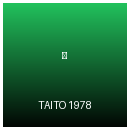 | 👾 **Space Invaders 1978** | `com.dor.spaceinvaders` | יריות חייזרים | חיצים לתנועה + אישור לירי | ~11 KB | [הורד IPK](https://github.com/dor2500/webos-tv-games/releases/download/v4.0.0/com.dor.spaceinvaders_1.0.0_all.ipk) |
| 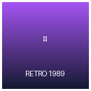 | 🧩 **טטריס קלאסי** | `com.dor.tetris` | פאזל רטרו | חיצים להזזה + למעלה לסיבוב | ~11 KB | [הורד IPK](https://github.com/dor2500/webos-tv-games/releases/download/v4.0.0/com.dor.tetris_1.0.0_all.ipk) |

---

## 🎮 מיפוי מקשים מלא לשלטי LG TV (Keycodes Map)

| מקש בשלט LG Magic Remote | אירוע קלט בדפדפן | קוד מקש (Keycode) | פעולה במשחקים |
| :---: | :---: | :---: | :--- |
| **חץ ימינה (Right)** | `ArrowRight` | `39` | ריצה ימינה / סיבוב מבט / פנייה / מעבר משחק בארקייד |
| **חץ שמאלה (Left)** | `ArrowLeft` | `37` | ריצה שמאלה / סיבוב מבט / פנייה / מעבר משחק בארקייד |
| **חץ למעלה (Up)** | `ArrowUp` | `38` | קפיצה (מריו/דייב) / סיבוב בלוק (טטריס) / התקדמות קדימה |
| **חץ למטה (Down)** | `ArrowDown` | `40` | התכופפות / ירידה בסולם / הפלה מהירה (טטריס) |
| **כפתור אישור מרכזי (Wheel Click)** | `Enter` | `13` | ירי באקדח / קפיצה / בחירת משחק / כנפיים בפלאפי בירד |
| **כפתור חזור (Back Key)** | `Back / Esc` | `461` / `27` | יציאה מיידית מהמשחק וחזרה למסך הראשי של הארקייד |
| **סמן פוינטר (Pointer Mouse)** | `mousedown / mousemove` | `0` | מתיחת רוגטקה ב-Angry Birds / חיתוך חבלים ב-Cut the Rope / כיוון ב-Duck Hunt |

---

## 🚀 4 דרכי התקנה והפעלה בטלוויזיה (Installation Methods)

### שיטה 1: התקנה מהירה ואוטומטית באמצעות סקריפט (מומלץ)
```powershell
# הרצת סקריפט הפריסה האוטומטי עבור חבילת הארקייד הראשית (גרסה 4.0.0 עם 206+ משחקים)
python deploy_to_tv.py packages/com.retrohub.nostalgia_4.0.0_all.ipk com.retrohub.nostalgia
```

### שיטה 2: התקנה דרך תוכנת webOS Dev Manager (ממשק גרפי)
1. הורד את תוכנת [webOS Dev Manager](https://github.com/webosbrew/dev-manager-desktop/releases) למחשב שלך.
2. חבר את התוכנה לטלוויזיה עם כתובת ה-IP ומפתח ה-SSH מאפליקציית Developer Mode.
3. גרור את קובץ `com.retrohub.nostalgia_4.0.0_all.ipk` ולחץ Install.

### שיטה 3: התקנה דרך שורת הפקודה הרשמית של LG (webOS CLI)
```bash
ares-install -d MyTV packages/com.retrohub.nostalgia_4.0.0_all.ipk
```

### שיטה 4: הפעלה ישירה אונליין בדפדפן הטלוויזיה (ללא צורך בהתקנה!)
* פתח את אפליקציית **דפדפן האינטרנט (Web Browser)** המובנית בטלוויזיה שלך.
* היכנס ישירות לכתובת ה-Cloud של הפרויקט:
  👉 **[https://dor2500.github.io/webos-tv-games](https://dor2500.github.io/webos-tv-games)**
* כל 206 המשחקים יטענו ישירות מהענן וניתנים למשחק מיידי עם שלט ה-Magic Remote!

---

## ⚡ מדריך אופטימיזציה ושיפור ביצועים ל-LG webOS (Deep Debloat Guide)

1. **ביטול איסוף נתונים ושירותי Live Plus:**
   * הגדרות (Settings) -> כל ההגדרות -> כללי (General) -> הגדרות נוספות -> כבה את **Live Plus**, **פרסום מותאם אישית** ו-**שיתוף נתוני צפייה**. ביטול זה משחרר תהליכי רקע כבדים של סריקת תוכן המסך בזמן אמת.
2. **הפעלת מצב תגובה מהירה למשחקים (Game Optimizer / ALLM):**
   * הקטנת ה-Input Lag למינימום האפשרי (פחות מ-10 מילי-שניות ב-OLED!).
3. **הארכת משך ה-Developer Mode (Keep-Alive):**
   * אפשר את מתג **Key Server** באפליקציית Developer Mode בטלוויזיה לחידוש אוטומטי של תוקף החיבור.
4. **ניקוי זיכרון RAM מהיר דרך השלט:**
   * לחיצה ארוכה על כפתור **Home (הבית)** מאפשרת סגירת כל אפליקציות הרקע הפתוחות המעמיסות על הזיכרון.

---

## 👨‍💻 תורמים וקרדיטים (Credits & Acknowledgments)

* **פיתוח, עברות והתאמת TV:** dor2500 & Google Deepmind Antigravity Pair-Programming Team.
* **זכויות יוצרים מקוריות:**
  * Rovio Entertainment (Angry Birds & Rio)
  * ZeptoLab (Cut the Rope)
  * Nintendo (Super Mario Bros, Duck Hunt, Mega Man, Castlevania)
  * SEGA & Sonic Team (Sonic the Hedgehog, Streets of Rage, Golden Axe)
  * id Software (DOOM, Wolfenstein 3D, Commander Keen)
  * John Romero (Dangerous Dave)
  * Namco (Pac-Man, Galaga, Dig Dug)
  * Taito (Space Invaders, Bubble Bobble)
  * Alexey Pajitnov (Tetris)
* פרויקט זה נוצר למטרות שימור היסטורי, חינוך ונוסטלגיה חופשית במסכי הטלוויזיה הביתיים.

---

<p align="center">
  <b>🌟 מצאתם את הפרויקט שימושי? פרגנו ב-Star (⭐) בראש העמוד למעלה! 🌟</b><br>
  נוצר באהבה עבור קהילת הגיימינג והטלוויזיות החכמות בישראל 🇮🇱
</p>
