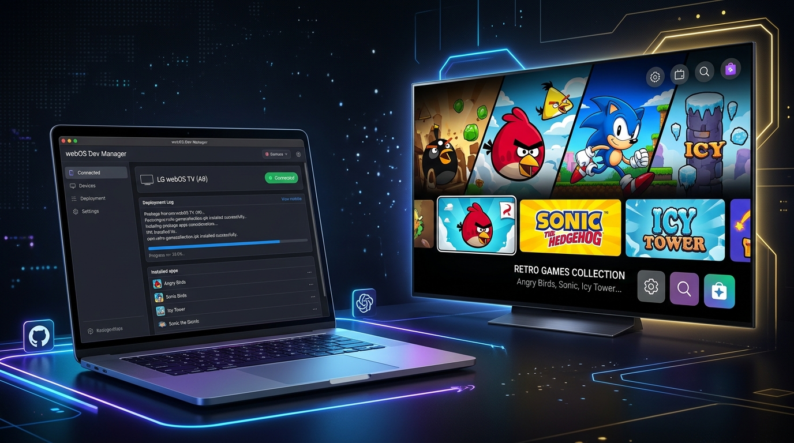
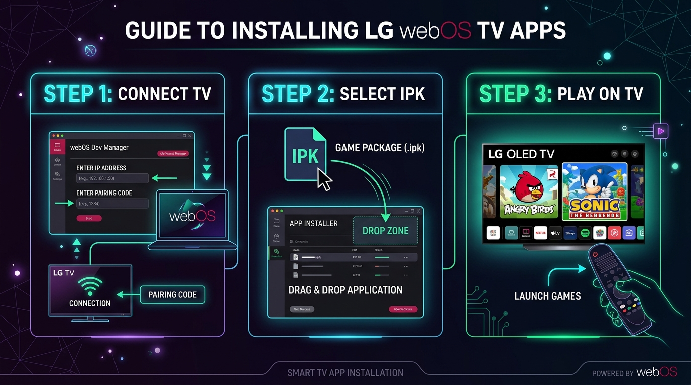

# 🎮 אוסף משחקי רטרו לטלוויזיות LG webOS (Smart TV)
### LG Smart TV webOS Retro Games Collection & Nostalgia Hub — IPK Packages & Install Guide

  

  
  
  
  

מאגר זה מרכז חבילות התקנה מסודרות (`.ipk`) של משחקי הרטרו הנוסטלגיים והאהובים ביותר שעברו התאמה מלאה ועברות למערכת ההפעלה **LG webOS** בטלוויזיות חכמות (LG OLED, QNED, NanoCell ו-UHD).

המערכת כוללת תמיכה מלאה ב-**Magic Remote**, שלטי גיימינג (Bluetooth / USB), מנועי סאונד מובנים ותצוגת 1080p ו-4K מרהיבה.

> [!TIP]
> 🌟 **הכי מומלץ למסך הסלון:** התקן את **ארקייד נוסטלגיה (Master Hub)** — אפליקציה אחת שכוללת בתוכה את כל 6 המשחקים עם תפריט ניאון מרשים, בחירת משחקים בשלט והפעלה מיידית בלחיצה אחת!

---

## 📦 רשימת החבילות להורדה ישירה

| אייקון | שם המשחק / האפליקציה | מזהה חבילה (App ID) | גרסה | תמיכה בשלטים | גודל קובץ | הורדה ישירה |
| :---: | :--- | :--- | :---: | :---: | :---: | :---: |
|  | 🌟 **ארקייד נוסטלגיה (Master Hub)** | `com.retrohub.nostalgia` | 1.0.0 | שלט LG + גיימפאד + פוינטר | ~33.8 MB | [הורד IPK מאוחד](https://github.com/dor2500/webos-tv-games/releases/download/v2.0.0/com.retrohub.nostalgia_1.0.0_all.ipk) |
|  | 🟡 **פאק-סוניקס בעברית** | `com.dor.pacxon` | 1.0.0 | חיצי שלט LG / גיימפאד | ~590 KB | [הורד IPK](https://github.com/dor2500/webos-tv-games/releases/download/v2.0.0/com.dor.pacxon_1.0.0_all.ipk) |
|  | 🛸 **אייר-קסוניקס 3D בעברית** | `com.dor.airxonix` | 1.0.0 | חיצי שלט LG / גיימפאד | ~780 KB | [הורד IPK](https://github.com/dor2500/webos-tv-games/releases/download/v2.0.0/com.dor.airxonix_1.0.0_all.ipk) |
|  | 💀 **דום קלאסי בעברית (DOOM)** | `com.idsoftware.doom` | 1.9.0 | חיצים + מקש אישור / גיימפאד | ~2.35 MB | [הורד IPK](https://github.com/dor2500/webos-tv-games/releases/download/v2.0.0/com.idsoftware.doom_1.9.0_all.ipk) |
|  | 🐦 **Angry Birds (הציפורים הכועסות)** | `com.rovio.angrybirds` | 4.0.0 | סמן Magic Remote (פוינטר) | ~1.93 MB | [הורד IPK](https://github.com/dor2500/webos-tv-games/releases/download/v2.0.0/com.rovio.angrybirds_4.0.0_all.ipk) |
|  | 🦔 **Ultimate Flash Sonic (בעברית)** | `com.sega.ultimateflashsonic` | 1.0.1 | חיצים + מקש אישור / גיימפאד | ~24.58 MB | [הורד IPK](https://github.com/dor2500/webos-tv-games/releases/download/v2.0.0/com.sega.ultimateflashsonic_1.0.1_all.ipk) |
|  | 🏰 **Icy Tower - מהדורת מריו HD** | `com.freelunchdesign.icytower` | 1.3.1 | חיצים + מקש אישור / גיימפאד | ~3.07 MB | [הורד IPK](https://github.com/dor2500/webos-tv-games/releases/download/v2.0.0/com.freelunchdesign.icytower_1.3.1_all.ipk) |

---

## 🕹️ פירוט על המשחקים הנוסטלגיים ואופן השליטה

### 🌟 0. ארקייד נוסטלגיה (Master Retro Hub)
* **תיאור:** דשבורד חכם ומרהיב בעיצוב טלוויזיוני עתידני המאחד את כל 6 המשחקים תחת קורת גג אחת!
* **תכונות:** קרוסלת משחקים חלקה, צלילי ממשק בסגנון ארקייד, תיאור מלא והוראות לכל משחק בעברית, מעבר מיידי למשחק בלחיצת כפתור, וחזרה נוחה לתפריט עם כפתור Back בשלט.

---

### 🟡 1. פאק-סוניקס בעברית (Pac-Xon)
* **תיאור:** השילוב האגדי בין פאקמן לקסוניקס שכבש מיליוני שחקנים. צא מגבולות המסגרת, חתוך שטחים, כבוש 80% מלוח המשחק והיזהר שהרוחות הצבעוניות (בלינקי, פינקי, אינקי וקלייד) לא יפגעו בשובל שלך!
* **בונוסים:** 🍌 בננה ודובדבנים לניקוד • ⏱️ שעון עצר להקפאת רוחות • ⚡ ברק למהירות על • 💊 גלולת כוח לטריפת רוחות.
* **שליטה בשלט LG:** חיצי ה-D-Pad לניווט פאקמן, מקש אישור (Wheel / OK) להשהיה.

---

### 🛸 2. אייר-קסוניקס 3D בעברית (AirXonix 3D)
* **תיאור:** גרסת תלת-מימד מרהיבה של המשחק הקלאסי. רחפן פרופלור צהוב שמרחף מעל זירה תלת-מימדית וגוזר חלקים. שטחים שנסגרים ללא כדורים קוצניים מתרוממים כבלוקים מוגבהים ונכבשים.
* **שליטה בשלט LG:** חיצי השלט להטיית הרחפן ותנועה בזירה התלת-מימדית.

---

### 💀 3. דום קלאסי בעברית (DOOM 1.9 Shareware)
* **תיאור:** משחק היריות התלת-מימדי המהפכני של id Software משנת 1993, מבוסס על קובץ ה-`DOOM1.WAD` המקורי! כולל את תחנת מאדים (E1M1), רובי ציד, נשקים, מפלצות זומבים, שדים וממשק סטטוס-בר מלא בעברית (בריאות, שריון, תחמושת).
* **שליטה בשלט LG:** חיצים קדימה/אחורה להליכה, חיצים ימינה/שמאלה לסיבוב מבט, מקש אישור (OK) לירי ברובה ופתיחת דלתות. תמיכה מלאה גם בשלטי גיימינג בלוטוס!

---

### 🐦 4. Angry Birds (אנגרי בירדס)
* הגרסה המקורית שמשוחקת בצורה המושלמת ביותר עם שלט **LG Magic Remote**: כוון את הסמן (הפוינטר) על המסך אל הרוגטקה, לחץ והחזק את כפתור הגלגלת, משוך לאחור ושחרר!

---

### 🦔 5. Ultimate Flash Sonic (סוניק בעברית)
* משחק הפלאש של סוניק בתרגום מלא לעברית עם מנוע WebAssembly מהיר. שחק עם סוניק, טיילס, נאקלס או קרים.

---

### 🏰 6. Icy Tower מהדורת מריו (אייסי טאוור)
* מגדל הקרח האהוב בגרפיקת 4K חדה, אפקטים ושמיים משתנים וקפיצות קיר ענקיות (Super Jumps) בעברית.

---

## 🛠️ מדריך התקנה שלב-אחר-שלב

  

### שיטה מומלצת: התקנה עם webOS Dev Manager במחשב
1. פתח בטלוויזיה את אפליקציית **Developer Mode** וודא שהמתגים **Dev Mode Status** ו-**Key Server** מופעלים (ON).
2. פתח את **webOS Dev Manager** במחשבך (`C:\Program Files\webOS Dev Manager\webos-dev-manager.exe`).
3. התחבר לטלוויזיה בלחיצה על **Connect**.
4. לחץ על **Install App** או **גרור ושחרר (Drag & Drop)** את קובץ ה-IPK שברצונך להתקין (למשל `com.retrohub.nostalgia_1.0.0_all.ipk` הכולל את הכל) אל חלון התוכנה.
5. תוך מספר שניות המשחק יותקן ויופיע בסרגל האפליקציות במסך הבית של הטלוויזיה! 🎉

---

## ⚖️ זכויות יוצרים והבהרה משפטית
* הפרויקט נועד למטרות שימור היסטורי, הנגשה ונוסטלגיה עבור קהילת ה-Homebrew של LG webOS.
* כל הזכויות והסימנים המסחריים שמורים לבעליהם המקוריים (AxySoft, id Software, Rovio, SEGA, Free Lunch Design).
