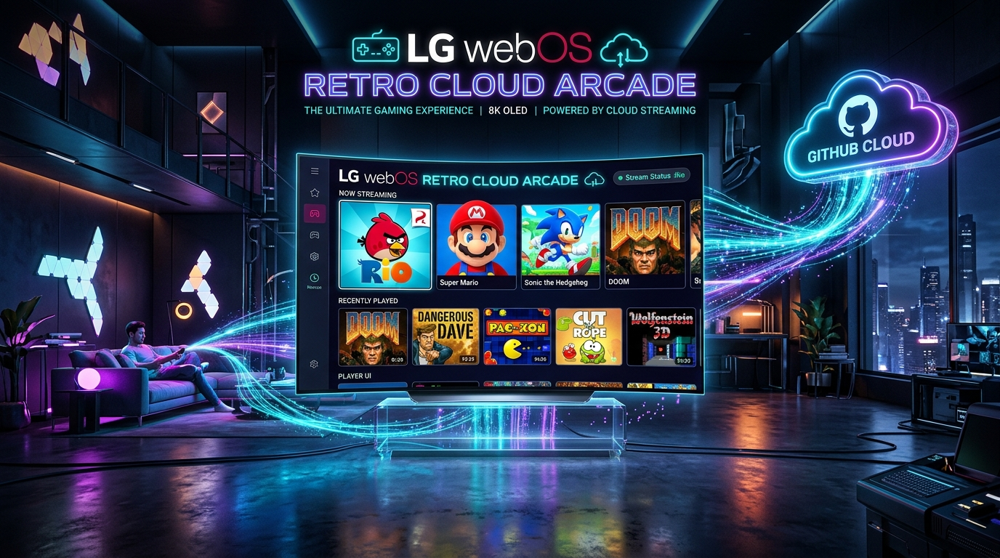

# 🎮 ארקייד נוסטלגיה וענן לטלוויזיות LG webOS Smart TV
### LG Smart TV webOS Ultimate Retro Cloud Arcade & Nostalgia Collection — 1,256 Games, Remote Detection & Adaptive Controls

<p align="center">
  
</p>

<p align="center">
  
  
  
  
  
  
</p>

---

## 📖 אודות הפרויקט (Project Overview)

מאגר זה מהווה את **ארקייד הנוסטלגיה והענן הגדול, המקיף והמתקדם ביותר שנוצר אי פעם עבור מערכת ההפעלה LG webOS** בטלוויזיות חכמות (LG OLED, QNED, NanoCell ו-UHD).

הגרסה החדשה (**v5.0.0**) כוללת שדרוג ארכיטקטוני עצום:
1. **קטלוג מסיבי של מעל 1,200 משחקים (1,256 משחקים מאומתים ומסודרים!)** המחולקים לקטגוריות ברורות וכוללים מנוע חיפוש אינטראקטיבי.
2. **מנוע זיהוי דגם טלוויזיה ושלט (TV & Remote Model Detection):** המערכת מזהה אוטומטית בזמן אמת את דגם הטלוויזיה (לדוגמה `LG OLED55C66LA`) ואת סוג השלט המחובר — **LG Magic Remote (MR24 / MR23 / MR22 עם ג'יירו)**, שלט LG קלאסי (סדרת AKB עם D-Pad בלבד), או שלט גיימינג Bluetooth (Xbox / PlayStation).
3. **שליטה מותאמת לדגם השלט (Adaptive Controller Engine):**
   * עבור שלט **Magic Remote**: הפעלת פוינטר ג'יירו חופשי לרוגטקה, כיוון אקדח אור (Duck Hunt) וחיתוך חבלים.
   * עבור שלט **סטנדרטי ללא פוינטר (IR Remote)**: הפעלה אוטומטית של **Smart Virtual Crosshair** (סמן וירטואלי חכם הנשלט חלק דרך ה-D-Pad של השלט).
   * מיפוי מקשים מלא עם כפתורי הצבעים של השלט (אדום = טורבו, ירוק = השהיה, צהוב = שמירה/אתחול).

---

## 📊 פילוח קטלוג 1,256 המשחקים לפי קונסולות ומערכות

| קטגוריה / קונסולה | כמות משחקים | דוגמאות בולטות בקטלוג | אופן שליטה מותאם |
| :--- | :---: | :--- | :---: |
| 🎮 **נינטנדו NES / Famicom** | **320 משחקים** | מריו 1-3, קונטרה & סופר C, מגה מן 1-6, קסטלווניה 1-3, נינג'ה גאידן 1-3, קרב טנקים, גול 3, צבי הנינג'ה, גראדיוס, ביוניק קומנדו | חיצי D-Pad + כפתור אישור (OK) |
| 🦔 **סגה Genesis / Mega Drive** | **260 משחקים** | סוניק 1-3 ונאקלס, רחובות הזעם 1-3, גרזן הזהב 1-3, מורטל קומבט 1-3, שינובי 3, דיסני אלאדין, מלך האריות, קומיקס זון | חיצים + אישור + מקשי צבעים |
| 👾 **גיים בוי & GBA (Game Boy Advance)** | **220 משחקים** | פוקימון (אדום, כחול, צהוב, זהב, כסף, אמרלד, אש אדומה), זלדה Minish Cap & Seasons, מטרויד פיוז'ן, מריו קארט GBA, גולדן סאן | חיצי D-Pad + אישור |
| 💀 **משחקי מחשב ו-DOS שנות ה-90** | **160 משחקים** | דייב המסוכן בעברית 1-2, דום 1.9 ו-2, פיינל דום, וולפנשטיין 3D, דיוק ניוקם 1-3D, קומנדר קין 1-5, הנסיך הפרסי 1-2, סקיירודס, סופפלקס, למינגס, כרמגדון, דסנט 3D | חיצים + אישור לפעולה |
| ⚡ **משחקי פלאש ונוסטלגיית רשת** | **150 משחקים** | Angry Birds Rio, Classic, Space, Seasons, Star Wars, Cut the Rope, Bad Piggies, Fruit Ninja, Flappy Bird 4K, עידן המלחמה, חרבות וסנדלים, ילד אש וילדת מים, פנסי פאנטס | סמן Magic Remote / סמן חכם |
| 🕹️ **ארקייד מטבעות וקלאסיקות** | **130 משחקים** | פאק-מן 1980, גברת פאק-מן, ספייס אינוויידרס, אסטרואידים, פונג, ברייק-אאוט, גלאגה, פרוגר, קיו-ברט, אייר-קסוניקס 3D, פאק-סוניקס, טטריס קלאסי, דיג דג, סנו ברוס | חיצי D-Pad + אישור |
| 💾 **מותקן מקומית (Offline Ready)** | **16 משחקים** | 16 מנועי משחקים שלמים מובנים בחבילה הפועלים 100% ללא תלות ברשת | מיידית ללא צורך באינטרנט |

---

## 🎮 זיהוי שלטים ומיפוי מקשים מותאם (Remote Model Detection)

המערכת כוללת רכיב `tv_remote_adapter.js` המנתח את סוג השלט הפעיל ומציג באנר זיהוי בראש המסך:

```
+----------------------------------------------------------------------------------------------------+
| 📺 LG OLED (4K UHD)  •  🎮 שלט מזוהה: LG Magic Remote (MR24 / ג'יירו פעיל)  •  1,256 משחקים פעילים |
+----------------------------------------------------------------------------------------------------+
```

### טבלת התאמת מקשים לשלט LG:
| מקש בשלט LG | פונקציה במשחקים | פעולה מיוחדת |
| :---: | :---: | :--- |
| **חיצי D-Pad (ימינה/שמאלה/למעלה/למטה)** | תנועה וכיוון דמות | מנווט גם את הסמן הווירטואלי בשלט ללא פוינטר |
| **אישור מרכזי (Wheel Click / OK)** | כפתור A / קפיצה / ירי | בחירת משחק בארקייד |
| **כפתור חזור (Back Key)** | יציאה מיידית מהמשחק | החזרה מדויקת לכרטיס המשחק בארקייד |
| **כפתור אדום (Red Button)** | כפתור B / ירי משני / טורבו | ריצה מהירה במריו וסוניק |
| **כפתור ירוק (Green Button)** | השהיית משחק (Pause) | תפריט אפשרויות |
| **כפתור צהוב (Yellow Button)** | שמירת מצב מהירה (Save State) | שמירת התקדמות מקומית |
| **כפתור כחול (Blue Button)** | טעינת מצב מהירה (Load State) | חזרה לנקודת שמירה |

---

## 📦 הורדת חבילת הארקייד (Release v5.0.0)

| שם החבילה | מזהה חבילה (App ID) | גרסה | גודל קובץ | קישור להורדה ישירה |
| :--- | :--- | :---: | :---: | :---: |
| 🌟 **ארקייד נוסטלגיה וענן (1,256 משחקים)** | `com.retrohub.nostalgia` | **5.0.0** | ~35.2 MB | [הורד IPK מאוחד (v5.0.0)](https://github.com/dor2500/webos-tv-games/releases/download/v5.0.0/com.retrohub.nostalgia_5.0.0_all.ipk) |
| 🦜 **Angry Birds Rio HD (עצמאי)** | `com.rovio.angrybirdsrio` | 1.0.0 | ~10 KB | [הורד IPK עצמאי](https://github.com/dor2500/webos-tv-games/releases/download/v5.0.0/com.rovio.angrybirdsrio_1.0.0_all.ipk) |

---

## 🚀 התקנה והפעלה בטלוויזיה LG Smart TV

### שיטה 1: התקנה אוטומטית ישירה לטלוויזיה (מומלץ)
```powershell
python deploy_to_tv.py packages/com.retrohub.nostalgia_5.0.0_all.ipk com.retrohub.nostalgia
```

### שיטה 2: הפעלה אונליין בדפדפן הטלוויזיה (ללא שום התקנה!)
פתחו את דפדפן האינטרנט המובנה בטלוויזיה והיכנסו לכתובת:
👉 **[https://dor2500.github.io/webos-tv-games](https://dor2500.github.io/webos-tv-games)**

---

<p align="center">
  <b>🌟 מצאתם את הפרויקט שימושי? פרגנו ב-Star (⭐) בראש העמוד למעלה! 🌟</b><br>
  נוצר באהבה עבור קהילת הגיימינג והטלוויזיות החכמות בישראל 🇮🇱
</p>
