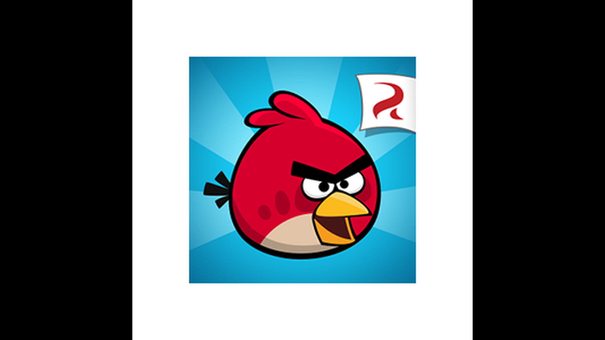
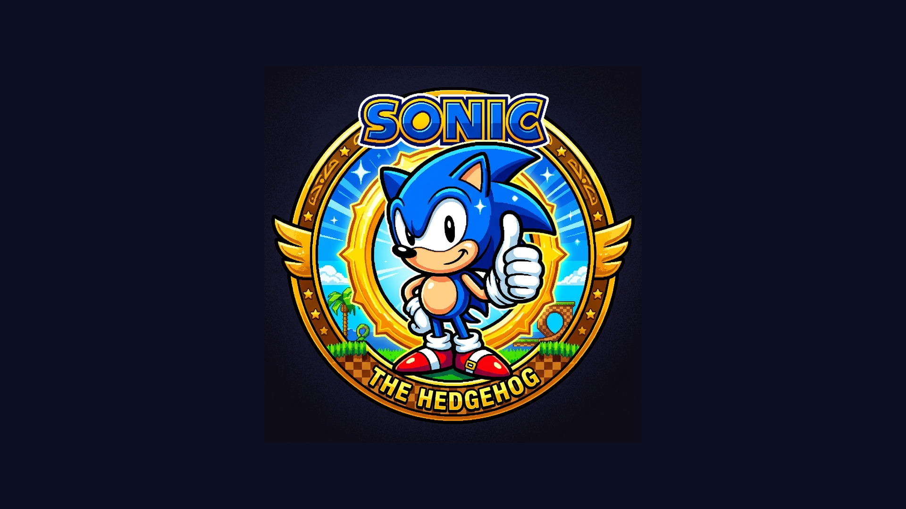
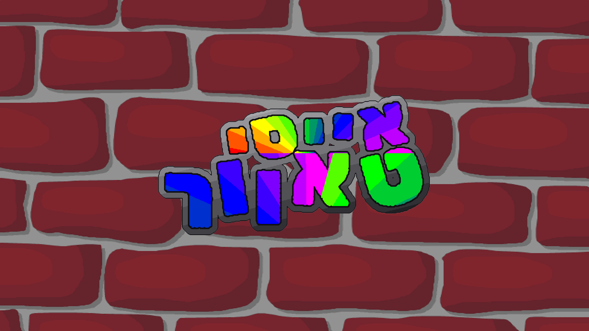

# 🎮 אוסף משחקי רטרו לטלוויזיות LG webOS (Smart TV)
### LG Smart TV webOS Retro Games Collection — IPK Packages & Install Guide

<p align="center">
  
</p>

<p align="center">
  
  
  
  
</p>

מאגר זה מרכז חבילות התקנה מסודרות (`.ipk`) של משחקי רטרו קלאסיים שעברו התאמה מלאה למערכת ההפעלה **LG webOS** בטלוויזיות חכמות (LG OLED, QNED, NanoCell ו-UHD), כולל תמיכה ב-**Magic Remote**, שלטי גיימינג (Bluetooth / USB) ואיכות תצוגה מותאמת למסך הגדול (1080p ו-4K).

---

## 📦 המשחקים בחבילה

| אייקון | שם המשחק | מזהה חבילה (App ID) | גרסה | תמיכה בשלטים | גודל קובץ | הורדה ישירה |
| :---: | :--- | :--- | :---: | :---: | :---: | :---: |
|  | **Angry Birds** | `com.rovio.angrybirds` | 4.0.0 | סמן Magic Remote (פוינטר) | ~1.9 MB | [הורד קובץ IPK](https://github.com/dor2500/webos-tv-games/releases/download/v1.0.0/com.rovio.angrybirds_4.0.0_all.ipk) |
|  | **Ultimate Flash Sonic** (בעברית) | `com.sega.ultimateflashsonic` | 1.0.1 | חיצי שלט / גיימפאד | ~24.5 MB | [הורד קובץ IPK](https://github.com/dor2500/webos-tv-games/releases/download/v1.0.0/com.sega.ultimateflashsonic_1.0.1_all.ipk) |
|  | **Icy Tower - מהדורת מריו** | `com.freelunchdesign.icytower` | 1.3.1 | חיצים + מקש אישור / גיימפאד | ~3.0 MB | [הורד קובץ IPK](https://github.com/dor2500/webos-tv-games/releases/download/v1.0.0/com.freelunchdesign.icytower_1.3.1_all.ipk) |

---

## 🕹️ פירוט על המשחקים ואופן השליטה

### 1. 🐦 Angry Birds (גרסת LG webOS מיוחדת)
<p align="center">
  
</p>

* **תיאור:** הגרסה הקלאסית והאהובה של הציפורים הכועסות נגד החזירים הירוקים, מותאמת ב-100% לחוויית סלון.
* **שליטה עם שלט LG Magic Remote:**
  * **מתיחה וירי:** כוון את הפוינטר (הסמן שעל המסך) אל הרוגטקה, לחץ והחזק את כפתור הגלגלת / אישור (`Wheel / OK`), משוך לאחור ושחרר כדי לשגר!
  * **הפעלת יכולות מיוחדות:** לחיצה נוספת באוויר מפעילה את הכוח של הציפור (האצה של צ'אק הצהוב, פיצוץ של בומב השחור, פיצול שלוש הציפורים הכחולות).
  * **חזרה:** כפתור `Back` בשלט מחזיר לבחירת שלבים / תפריט ראשי.

---

### 2. 🦔 Ultimate Flash Sonic — מהדורה בעברית
<p align="center">
  
</p>

* **תיאור:** משחק הפלאש האגדי של סוניק הקיפוד בתרגום מלא לעברית, רץ בצורה חלקה בטלוויזיה בעזרת מנוע WebAssembly / Ruffle מותאם ל-webOS. כולל 4 דמויות לבחירה: **סוניק**, **טיילס**, **נאקלס** ו**קרים**.
* **שליטה:**
  * **חיצים (D-Pad בשלט):** ימינה / שמאלה לריצה, חץ למטה להתקפלות / גלגול Spin Dash, חץ למעלה למבט מעלה.
  * **מקש אישור (OK / Center Click):** קפיצה / סיבוב באוויר.
  * **טיילס (Tails):** קפיצה כפולה מאפשרת לעוף באוויר!
  * **נאקלס (Knuckles):** קפיצה מאפשרת דאייה וטיפוס על קירות!
  * **שלטי גיימינג (Bluetooth / USB):** תמיכה מלאה בסטיק ובמקשי A/B/X/Y.

---

### 3. 🏰 Icy Tower — מהדורת סופר מריו (עברית & HD 4K)
<p align="center">
  
</p>

* **תיאור:** מגדל הקרח האהוב והממכר בעיצוב סופר מריו עם ממשק מלא בעברית, גרפיקת HD חדה המותאמת למסכי 4K ו-8K, צלילים מקוריים ואפשרות לבחור בין מהדורה קלאסית למהדורה מודרנית עם שמיים משתנים ומצבי משחק.
* **שליטה:**
  * **חצים (ימינה / שמאלה):** ריצה וצבירת תנופה. ככל שרצים מהר יותר, מקבלים קפיצות קיר ענקיות (Super Jumps)!
  * **מקש אישור (OK / Wheel Click) או חץ למעלה:** קפיצה.
  * **מקש Back:** השהיית המשחק (Pause) וחזרה לתפריט.

---

## 🛠️ מדריך התקנה שלב-אחר-שלב

<p align="center">
  
</p>

ישנן מספר דרכים פשוטות להתקין את קבצי ה-IPK על גבי טלוויזיית LG. הדרך המומלצת ביותר היא שימוש בתוכנת **webOS Dev Manager**.

---

### שיטה 1 (הכי מומלצת): התקנה דרך webOS Dev Manager במחשב

תוכנת **webOS Dev Manager** היא כלי גרפי רשמי/קהילתי למחשב (Windows / Mac / Linux) שמאפשר להתחבר לטלוויזיה בלחיצת כפתור ולהתקין עליה אפליקציות.

#### שלב 1: הכנת הטלוויזיה (מצב מפתח - Developer Mode)
1. היכנס לחנות האפליקציות בטלוויזיה (**LG Content Store** או **Apps**).
2. חפש והתקן את האפליקציה: **`Developer Mode`**.
3. פתח את האפליקציה והתחבר עם חשבון LG Developer (ניתן להירשם בחינם ב-[webostv.developer.lge.com](https://webostv.developer.lge.com)).
4. הפעל את המתג **`Dev Mode Status`** למצב **ON**.
5. הפעל את המתג **`Key Server`** למצב **ON**.
6. על המסך יוצגו כתובת ה-IP של הטלוויזיה (למשל `192.168.1.5`) וקוד האימות בן 6 תווים (**Passphrase**).

#### שלב 2: חיבור webOS Dev Manager
1. הורד והפעל את תוכנת [webOS Dev Manager](https://github.com/webosbrew/dev-manager/releases) במחשב.
2. לחץ על **Add Device** (הוסף מכשיר):
   * **Host:** הזן את כתובת ה-IP של הטלוויזיה (לדוגמה `192.168.1.5`).
   * **Port:** השאר `9922` (עבור Dev Mode) או `22` (לטלוויזיות שעברו Root).
   * **Passphrase:** הזן את הקוד שמופיע על מסך הטלוויזיה.
3. לחץ על **Connect** — המכשיר יחובר בהצלחה ותראה מחוון ירוק.

#### שלב 3: התקנת המשחקים
1. בחלון התוכנה, לחץ על הכפתור **Install** (או **Install App**).
2. בחר את קובץ ה-`.ipk` שברצונך להתקין מתיקיית [packages/](packages/):
   * `com.rovio.angrybirds_4.0.0_all.ipk`
   * `com.sega.ultimateflashsonic_1.0.1_all.ipk`
   * `com.freelunchdesign.icytower_1.3.1_all.ipk`
3. לחלופין — ניתן פשוט **לגרור ולשחרר (Drag & Drop)** את קובץ ה-IPK ישירות אל תוך חלון התוכנה!
4. תוך מספר שניות תופיע הודעה שהאפליקציה הותקנה בהצלחה, והאייקון של המשחק יופיע בסרגל האפליקציות בטלוויזיה! 🎉

---

### שיטה 2: התקנה ישירה דרך Homebrew Channel (לטלוויזיות עם Root)

אם הטלוויזיה שלך עברה פריצה / Root ומותקן עליה ה-**Homebrew Channel**:
1. העתק את קבצי ה-IPK לדיסק-און-קי (USB Drive) וחבר אותו לטלוויזיה.
2. פתח את **Homebrew Channel** בטלוויזיה.
3. עבור ללשונית **USB** או השתמש במנהל הקבצים המובנה.
4. בחר בקובץ ה-IPK ולחץ **Install**.

---

### שיטה 3: התקנה דרך שורת הפקודה (ares-cli)

למשתמשים מתקדמים או מפתחים עם webOS SDK:
```powershell
# התקנת המשחקים ישירות מול הטלוויזיה
ares-install --device tv packages/com.rovio.angrybirds_4.0.0_all.ipk
ares-install --device tv packages/com.sega.ultimateflashsonic_1.0.1_all.ipk
ares-install --device tv packages/com.freelunchdesign.icytower_1.3.1_all.ipk
```

---

## ❓ שאלות נפוצות ופתרון בעיות (FAQ)

<details>
<summary><b>⏱️ הטיימר של מצב מפתח (Dev Mode) פג תוקף, מה עושים?</b></summary>

באופן רשמי, LG מקצה 1000 שעות של Developer Mode ולאחר מכן צריך לחדש את הסשן:
1. פתח את אפליקציית **Developer Mode** בטלוויזיה.
2. לחץ על **Extend Session** (הארכת זמן).
3. אם אתה משתמש ב-**webOS Dev Manager**, התוכנה כוללת אפשרות מובנית בהגדרות לחידוש אוטומטי של הסשן ברקע (Auto Renew Session).
</details>

<details>
<summary><b>🎮 האם ניתן לחבר שלט משחק (Xbox / PlayStation)?</b></summary>

**כן!** טלוויזיות LG webOS תומכות בחיבור בקרי משחק אלחוטיים דרך Bluetooth או בחיבור ישיר עם כבל USB. לאחר החיבור, ניתן לשחק ב-Sonic וב-Icy Tower בנוחות מלאה עם השלט בדיוק כמו בקונסולה.
</details>

<details>
<summary><b>🔇 המשחק עלה אך אין סאונד בטלוויזיה?</b></summary>

ודא שהטלוויזיה אינה במצב Mute, ושמקור השמע בהגדרות הטלוויזיה מוגדר כ-**TV Speaker** (רמקול הטלוויזיה) או **Optical / HDMI ARC**. לחלק מהמשחקים מבוססי הדפדפן יש צורך בלחיצה ראשונה על המסך (קליק עם הסמן) כדי שהדפדפן יאפשר הפעלת אודיו (AudioContext policy).
</details>

---

## ⚖️ זכויות יוצרים והבהרה משפטית (Disclaimer)

* הפרויקט נועד למטרות שימור היסטורי, חינוך ונוסטלגיה עבור קהילת ה-Homebrew של LG webOS.
* כל הסימנים המסחריים, השמות, הגרפיקות והקניין הרוחני של המשחקים שייכים לבעליהם המקוריים (Rovio Entertainment, SEGA, Free Lunch Design).
* אם הינך בעל הזכויות ומעוניין בהסרת תוכן מסוים, אנא פתח Issue במאגר.
